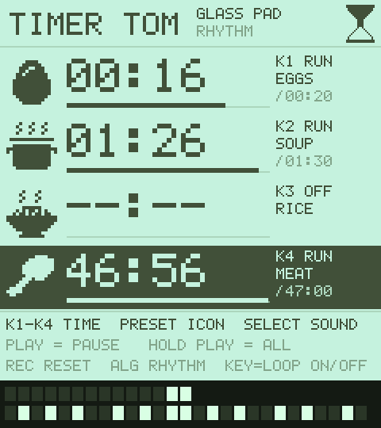

<div align="center">

# Timer Tom

**Four kitchen timers for the M-VAVE FM-1: set them on K1–K4, pick a dish icon, start one or all with PLAY. Every running timer adds one layer of soft ambient-techno percussion, every key starts its own melodic loop, and the key lights run like an hourglass.**

[](https://github.com/orion-musica/timer-tom-FM-1/actions/workflows/build.yml)


[**Website & web installer**](https://orion-musica.github.io/timer-tom-FM-1/) ·
[Manual](https://orion-musica.github.io/timer-tom-FM-1/manual/) ·
[Controls](#controls) ·
[Build](#building-from-source) ·
[License](#license)



</div>

---

> [!WARNING]
> **Timer Tom 0.1 is a beta, tested on hardware.** It has passed testing on an original M-VAVE FM-1
> (FCC ID: 2ARCP-FM1). Every build also passes host tests that run its real screen code and render its
> sound. Back up your projects, voices and samples before installing.
> The web installer can always put the original V15 firmware back.

## What it is

A kitchen multi-timer for cooking several dishes at once. All four timers stay on one screen with
their dish icons, the time left and a bar that empties like sand. The bottom lines always say which
knobs and buttons work. While the food cooks, every running timer plays one element of a soft, blurred ambient-techno
groove (timer 1 the kick, 2 an open hat, 3 a rim with dub echo, 4 a shaker), every key starts a calm, slow
looped melodic background line that moves on to the next key by itself after a while, and the keyboard lights show an hourglass with a grain falling on every
beat. Instead of the groove you can have a plain soft clock tick.

The sequencer and sound engines are M-VAVE's FM1 Open library. Timer Tom changes the app layer only:
the KITCHEN page (`app/kitchen.inc`), the start screen and the hooks in `app/screen.c`.

## Controls

| Control | Action |
|---|---|
| `K1`–`K4` | Set timer 1–4 (5 s / 15 s / 30 s / 1 min / 5 min steps, up to 4 h) and make it active. A running, paused or ringing timer is only selected by the first click. |
| `PRESETS` | Dish icon of the active timer: eggs, pasta, rice, potato, soup, meat, fish, pizza, cake, bread, veg, tea |
| `PLAY` | Start / pause the active timer; alarm off when it is ready |
| `PLAY` held | All alarms off, or start all set timers, or pause all running ones |
| `REC` | Reset the active timer to its time; again to clear it |
| `SELECT` | Sound of the loops: glass pad, strings, warm pad, choir |
| `ALGORITHM` | SILENT, TICK 1, TICK 2 or RHYTHM (one drum per running timer, the default) |
| Keys | Each of the 27 keys starts its own calm 4-bar loop; the same key stops it, another key switches. After four rounds (about 33 s) the loop moves on to the next key by itself |
| `HOME` | Stop the loop |
| `OCT −` / `OCT +` | Transpose the loop by octaves |
| `HOME` + `PLAY` | Stop all sounds |

## Lights

| Light | Shows |
|---|---|
| Black keys | Upper bulb: sand left in the first timer to end, going out from the edges |
| White keys | Lower bulb: filling from the middle outwards |
| Middle black, then middle white key | One grain per beat (RHYTHM) or per second (TICK) |
| The key of the running loop | Blinks twice a second |
| All keys swapping 4× a second | A timer is ready |
| `PLAY` | Half of every second while timers run; fast while one is ready |
| `REC` | The active timer can be reset |
| `OCT −` / `+` | Keys shifted down / up |

## Sounds

| Track | Engine | Job |
|---|---|---|
| T1 | DX7 (factory SYN PAD 6, STRING 5, SYN PAD 4, VOICE 8) | Key loops on the engine sequencer: 64 steps, eight tied notes; slow sine LFO, slow attack, long release, reverb and delay |
| T2 | DRUM 808 rimshot, short and high | The tick (TICK modes), tick-tock velocities, a little clearer in the last 10 s |
| T3 | DX7 KALIMBA | Alarm: a three-note motif per timer every 2.4 s, for 3 minutes |
| T4 | DRUM 808, one lane per timer | Timer 1: long dark kick, four on the floor · 2: open hat on the offbeats, lots of reverb · 3: rim with dub delay · 4: maracas in sixteenths |

118 BPM with a little swing. A timer's drum lane is written into the pattern while it runs and cleared when it is paused or
ready (the alarm then tells which one); empty lanes cost no voices, so the CPU stays low. The loops
all stay in one key (A minor / C major pentatonic, no half steps): one long tied note per bar, moving
mostly by step, with almost no pitch wobble, so they stay calm in the background. Tracks 5–8 are off. Timers and loops are not saved; switching off clears them.

## Installation

1. **Back up.** Export the projects, voices and samples you want to keep.
2. **Open the installer** at <https://orion-musica.github.io/timer-tom-FM-1/install/> in desktop **Chrome or Edge**.
3. **Connect** the FM-1 with a USB data cable, press **START INSTALLER**, then **Connect device**, and allow MIDI / SysEx.
4. **From stock V15** the first time: click **Enable force flash and reconnect**.
5. **Install** and keep the FM-1 connected until the installer says it is done.

The firmware file is also attached to every release as `timer-tom.fwsc`, with its SHA-256.

## Building from source

### In the cloud (recommended)

Every push to `main` runs [`.github/workflows/build.yml`](.github/workflows/build.yml):

1. **host-test** (Linux): compiles the real app and screen code with the browser engine, plays the
   panel scripts in `tools/host/tests` and keeps the screenshots as an artifact.
2. **build** (Windows): installs the JieLi toolchain 2.5.3, builds the firmware, the web installer and the
   site, and uploads them as the `timer-tom` artifact.
3. **pages**: publishes `docs/` to GitHub Pages (public repository, Pages source set to *GitHub Actions*).
4. **release**: on a tag such as `v0.1.0-beta`, publishes a GitHub Release with `timer-tom.fwsc`.

### On Windows

Requires PowerShell, `curl.exe`, `tar.exe` and the
[JieLi Windows toolchain 2.5.3](https://jl-update.oss-cn-shenzhen.aliyuncs.com/2.5.3.exe).
Double-click `INSTALL-TIMER-TOM.bat`: it finds the toolchain, builds everything and opens the installer on
`http://localhost:8766`. By hand:

```powershell
$env:FM1_PI32_TOOLCHAIN = 'C:\JL\pi32'
$env:FM1_SOURCE_URL = 'https://github.com/orion-musica/timer-tom-FM-1/archive/refs/heads/main.zip'
.\tools\Make-Site.ps1        # firmware + installer + site in docs\
.\tools\Build-Web.ps1 -LocalPreview   # browser preview only
```

### Host test (Linux or macOS)

Needs `clang` (or `gcc` with `CC=gcc`) and Python 3 with Pillow for the pictures:

```sh
sh tools/host/build.sh
```

Screenshots land in `build/host/<test>/*.png` (the sound test also writes `.wav` files), each with the 41 panel LEDs drawn under the screen.
Test scripts are plain text; see the commands at the top of [`tools/host/harness.c`](tools/host/harness.c).

## Repository layout

| Path | Contents |
|---|---|
| `app/kitchen.inc` | **Timer Tom:** KITCHEN page, timers, icons, hourglass lights, tick, alarm, ambient sounds |
| `app/screen.c` | Screen and panel code (start screen, hooks into the KITCHEN page) |
| `app/`, `web/`, `third_party/` | FM1 Open application and browser engine sources |
| `sdk/` | FM1 Open SDK: binary engine, build and packaging scripts |
| `tools/host/` | Native host test harness and scripts (screenshots, LED states, WAV recordings) |
| `tools/icons.py` | The 12 dish icons as ASCII art; prints the C table |
| `tools/Make-Site.ps1`, `tools/ci/` | Site build and cloud toolchain setup |
| `docs/` | Website: landing page, installer page, manual |

## Credits

- **Timer Tom** by BULØKE (orion-musica). Code written together with Claude.
- Built on **[FM1 Open](https://github.com/m-vave/fm1_open)** by M-VAVE, via **3310** (DAW DANNY) and **Drum Peter**.
- Third-party components and their licenses: [`THIRD_PARTY.md`](THIRD_PARTY.md).

Not affiliated with M-VAVE. No phone maker's logo or name is used.

## License

The application is licensed under the GNU GPL version 3 with the FM1 SDK linking exception; see
[`LICENSE.md`](LICENSE.md). The device engine is supplied as a binary SDK under separate terms. Keep the
SDK terms, third-party licenses and notices when you distribute builds. The original FM1 Open README is in
[`README.FM1-OPEN.md`](README.FM1-OPEN.md).
